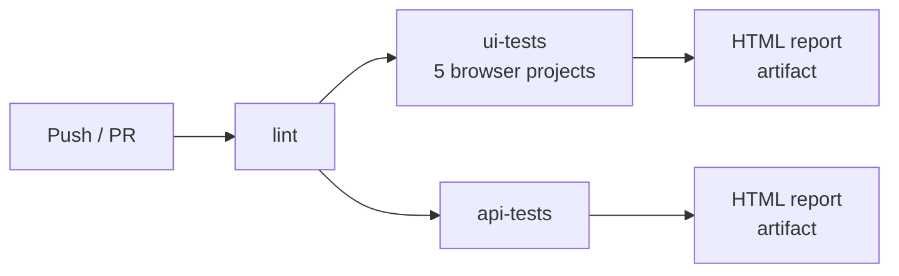

# Framework Overview

**One Playwright + TypeScript framework runs both suites:**

- **UI:** the OrangeHRM login page, in 5 browser projects (3 desktop, 2 mobile).
- **API:** the Swagger Petstore `POST /pet` endpoint.

Both suites share the same runner, config, fixtures, linting, reporting and CI pipeline, so there's one toolchain to learn and maintain.

---

## 2. Architecture

Each layer has one job:

| Layer | Responsibility | Knows about |
|---|---|---|
| **Tests** | What behaviour to check, and the assertions | Business actions only, such as `attemptLogin()` or `addPet()` |
| **Fixtures** | Create page objects and the API client for each test, and pass them in | Which objects exist and what they depend on |
| **Page objects / API client** | How to interact with the system: locators, waits, endpoints, HTTP calls | The page markup or the API paths |
| **Config** | Where to run (environment, URLs, credentials) and how (browsers, retries, reports) | Nothing about individual tests |

**The benefit:** a change to the system under test is fixed in one place. A new locator changes one page object, a new URL changes `environments.ts`, and the tests themselves don't change.

---

## 3. Key design decisions

| Decision | Why |
|---|---|
| **Page Object Model for UI** | Locators and actions live in one place per page. Tests read as user behaviour, not DOM queries |
| **Service object for API** | `petsAPI.ts` is the API equivalent of a page object. Tests never contain URLs or raw HTTP calls |
| **Playwright fixtures as dependency injection** | Tests declare what they need (`{ loginPage, petsApi }`) and Playwright builds it. Objects are only created when a test asks for them, so API tests never start a browser |
| **Assertions stay in tests** | Page objects and the client say *how*; tests say *what to check*. This keeps page objects reusable across many tests |
| **No hard-coded waits** | Page objects rely on Playwright's auto-waiting and retrying assertions, which matters on a slow shared demo site |
| **Keep it simple** | No base classes, no wrappers around Playwright's own API. Add abstractions only when there's duplication to remove |

---

## 4. Configuration and environments

- **`environments.ts`** holds the URLs and credentials for each environment (`local`, `preprod`). The `ENV` variable chooses one, defaulting to `preprod`.
- **Secrets are never committed.** Locally they come from `.env` (gitignored, created from `.env.example`). In CI they come from GitHub secrets.
- **Command-line values override `.env`**, e.g. `ENV=local npm run test:ui`.
- **Fails fast.** If credentials are missing, the run stops immediately with a message saying how to fix it, rather than failing deep inside a test.

**Adding an environment** is one new entry in `environments.ts`.

---

## 5. Quality gates and CI

- **Lint runs first** and fails the build in seconds. Type-aware ESLint rules catch a missing `await`, the most common Playwright bug.
- **UI and API run in parallel**, so a failure in one doesn't block feedback from the other.
- **Reports are always uploaded**, even when tests fail, and kept for 30 days.
- **Evidence on failure:** traces and screenshots for UI failures; API assertions include the response body.
- **Stability on CI:** up to 2 retries, 1 worker, and `test.only` is blocked.

---

## 6. Extending the framework

| To add... | Do this |
|---|---|
| A new page | Create a page object in `pages/`, register it as a fixture in `fixtures/test.ts` |
| A new API resource | Create a client in `api/`, register it as a fixture |
| A new test | Import `test` from `fixtures/test.ts` and request the fixtures it needs |
| A new environment | Add an entry to `environments.ts` |
| A new browser or device | Add a project to `playwright.config.ts` |
